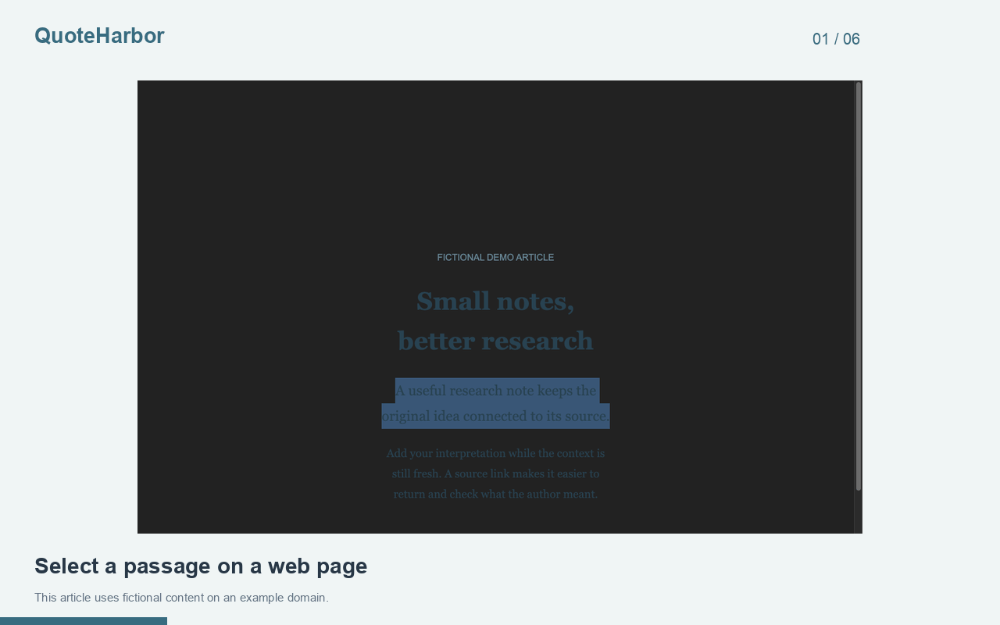

# QuoteHarbor

Good ideas deserve a safe harbor.

QuoteHarbor saves selected web passages with their source, your interpretation, and tags. Build a private research library, find a thought again, and export Markdown when it is time to write.

## Features

- Capture selected text from the current web page or paste a quote.
- Attach a source URL, a note, and tags to every clip.
- Save multiple clips from the same page.
- Search quotes, notes, titles, URLs, and tags in a local library.
- Edit clips, reopen source pages, and copy individual clips as Markdown.
- Export filtered Markdown or JSON backups; import valid backups.

## Limits

Stores up to 1,000 clips, with quotes and notes limited to 20,000 characters each. Capture works on permitted HTTP and HTTPS pages. Some pages, embedded frames, and browser PDF viewers do not allow capture; paste text manually when needed. QuoteHarbor does not highlight websites permanently, create verified academic citations, summarize with AI, or sync to a cloud. Existing MarginMemo notes migrate to the library on first open.

## Development

Open `chrome://extensions`, enable Developer mode, choose **Load unpacked**, and select `extension/`. All runtime assets are packaged locally.

Run `npm test` for logic tests. Run `npm run package` to validate and create an upload ZIP in `dist/`. No build step or runtime package dependencies are required.

## Privacy

Local data includes captured quote text, user-written notes, tags, source page titles and URLs, and timestamps. Capturing reads only the current selection in the top page frame when explicitly requested.

`activeTab` temporarily accesses the current page after you invoke the extension. `scripting` reads the selected text only when you choose Capture selected text. `storage` saves the library on your device. No background website scanning occurs.

See [PRIVACY.md](PRIVACY.md). No developer servers, advertising, or analytics.

## Support

Report reproducible bugs through this repository's issue tracker. Remove private information first.

## License

MIT.

## See it in action

[Watch the MP4](store/demo/walkthrough.mp4) · [Read the step-by-step guide](store/demo/README.md)
